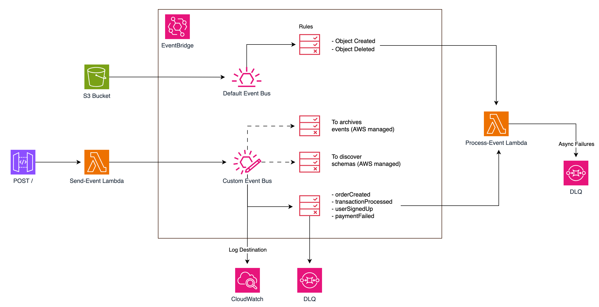
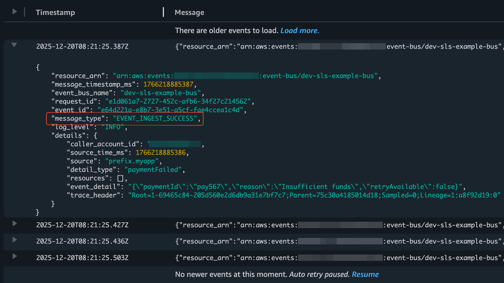
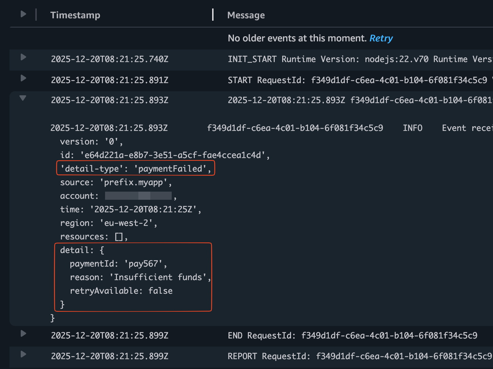
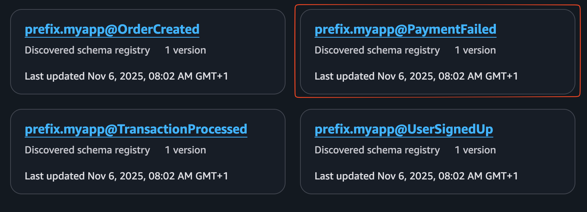
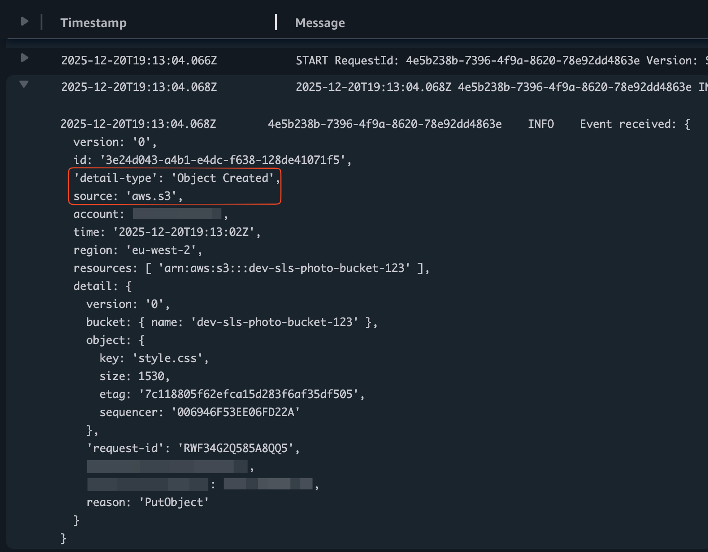

# event-bridge

This example project explores the EventBus feature of EventBridge by building a small event-driven application. 
It explains the components involved and shows how they work together to enable 
[event-driven architectures](https://aws.amazon.com/what-is/eda/).

The diagram below illustrates the architecture of the application:



## Overview

The following sections break down the components of the application and their roles.

1. EventBus `default`:
   - Managed by AWS and used for events generated by AWS services. E.g. Events from S3 buckets.

2. Rule `event-bridge-dev-processEvent-rule-1`:
   - Attached to the default event bus.
   - Matches events when an object is `uploaded` to or `deleted` from the `dev-sls-photo-bucket-123` bucket.
   - When matched, it triggers the `event-bridge-dev-processEvent` Lambda function.
   
3. Custom event bus `dev-sls-example-bus`:
   - Managed by the application infrastructure.
   - Used for publishing and consuming custom application events.

4. CloudWatch Log Group `/aws/vendedlogs/events/event-bus/dev-sls-example-bus`:
   - Attached to the custom event bus.
   - Both error and info logs from the custom event bus are sent to this log group.

5. Archive `dev-sls-archive`
   - Enabled on the custom event bus.
   - All events sent to the custom event bus are archived for 14 days.
   - AWS creates a rule to route all events to the archive.

6. Discoverer
   - Enabled on the custom event bus.
   - Generates schemas for all events sent to the custom event bus.
   - AWS creates a rule to route all events to the schema discoverer.

7. Rule `event-bridge-dev-processEvent-rule-2`:
   - Attached to the custom event bus.
   - Matches events when the following conditions are met:
     ```
     - the `source` attribute is prefix.myapp
     - the `detail-type` attribute is one of: orderCreated, transactionProcessed, userSignedUp, or paymentFailed
     ```
   - When matched, it triggers the `event-bridge-dev-processEvent` Lambda function.

8. Dead-letter queue `dev-sls-event-dead-letter-queue`:
   - Attached to the `event-bridge-dev-processEvent-rule-2` rule.
   - Events that cannot be successfully delivered to the `event-bridge-dev-processEvent` target are sent to this DLQ.
   - This DLQ captures delivery failures, not target execution failures. For example, if the rule lacks permission to invoke the Lambda function, it is considered a delivery failure.

9. S3 Bucket `dev-sls-photo-bucket-123`:
   - Configured to send notifications to the default event bus for all events occurring in this bucket.

10. Lambda function `event-bridge-dev-sendEvent`:
    - Triggered by the API Gateway to send custom events to the custom event bus.
    - In a real-world scenario, this could represent a microservice emitting events to the central event bus.

11. Lambda function `event-bridge-dev-processEvent`:
    - Invoked by rules on both the default and custom event buses when their conditions are met.
    - Logs the received event when invoked.
    - Configured with a Dead Letter Queue (DLQ) to capture async failures.

12. API Gateway endpoint `dev-event-bridge`:
    - Exposes a `POST` endpoint that triggers the `event-bridge-dev-sendEvent` Lambda function to publish custom events.
 
## Deployment

First, clone the project locally:

```shell
git clone git@github.com:m-sureshraj/serverless-examples.git
cd event-bridge
```

Install dependencies:

```shell
pnpm install
```

Deploy to AWS:

```shell
pnpm run deploy
```

A successful deployment prints stack outputs similar to:

```
✔ Service deployed to stack event-bridge-dev (26s)
endpoint: POST - https://xxx.execute-api.eu-west-2.amazonaws.com/
functions:
  sendEvent: event-bridge-dev-sendEvent (1.5 kB)
  processEvent: event-bridge-dev-processEvent (830 B)
Stack Outputs:
  ...
```

## Testing

### Test the custom event bus

Call the POST endpoint with one of the supported event types: `orderCreated`, `transactionProcessed`, `userSignedUp`, 
or `paymentFailed`. Each event type is mapped to a specific set of event details to enrich the published event.

```shell
# Replace the URL with the one from your deployment output

curl -X POST 'https://xxx.execute-api.eu-west-2.amazonaws.com' \
  --header 'Content-Type: application/json' \
  --data '{
  "eventType": "paymentFailed"  
}'
```

A successful invocation publishes the event to the custom event bus and returns a `200 OK` response. 

Inspect the custom event bus CloudWatch logs `/aws/vendedlogs/events/event-bus/dev-sls-example-bus` to see how the 
event was ingested, matched by the rule, and delivered to the Lambda target.



Finally, the rule invokes the `event-bridge-dev-processEvent` Lambda function, which logs the received event.



> [!NOTE]
> The event is archived in the `dev-sls-archive` and can be replayed if needed. 
> A schema is also generated by the discoverer and available in the EventBridge schema registry.



### Test default event bus

Uploading or deleting an object in the `dev-sls-photo-bucket-123` S3 bucket publishes an event to the default event bus, 
where the rule `event-bridge-dev-processEvent-rule-1` invokes the `event-bridge-dev-processEvent` Lambda function.


